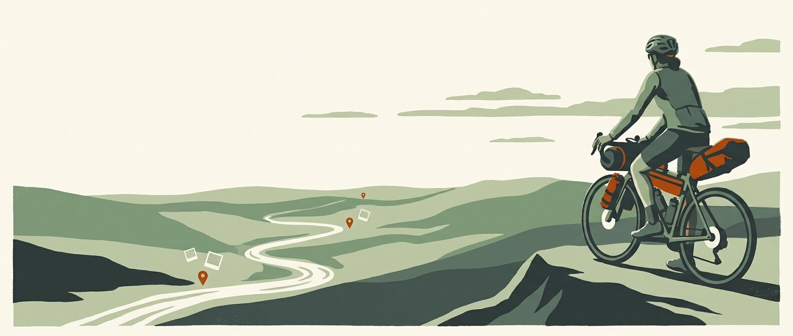
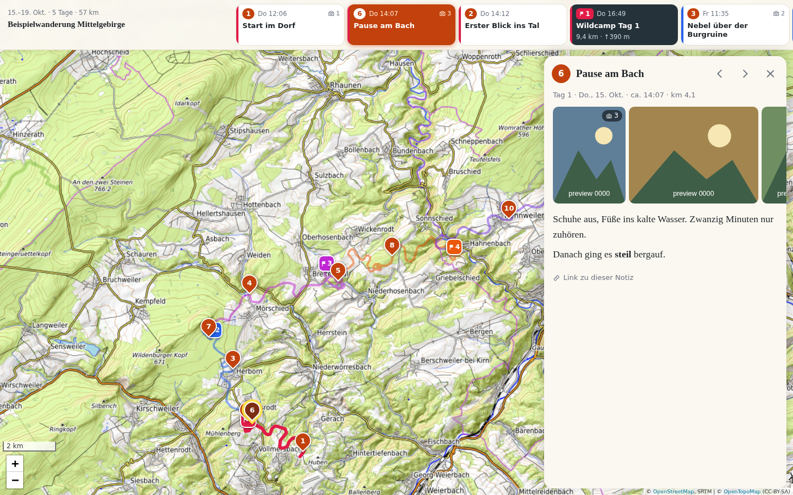
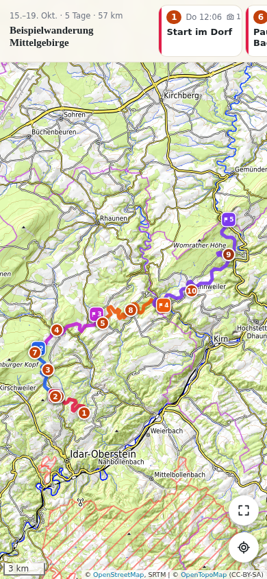

<p align="center"></p>

<table>
<tr>
<td width="100">

</td>
<td>
<h1>trip-diary</h1>
A map diary of a trip: your walked GPX tracks, numbered notes and the photos from your own Immich, on one phone-friendly page you can share with a link.
</td>
</tr>
</table>

[](https://github.com/frederikberg/trip-diary/actions/workflows/ci.yaml)
[](https://github.com/frederikberg/trip-diary/releases)
[](https://opensource.org/licenses/MIT)

You walk, you tap the map where something happened and write a few lines; the photos you took
are already in Immich and attach to the note by their capture time. Friends and family open a
link and read the trip as a strip of notes that moves the map along with it.

<p align="center"></p>

## Why

- **Your photos stay in Immich.** The app stores no media; it reads from your Immich with a read-only key and proxies every image and video, so no Immich address or key ever reaches a reader.
- **Writing happens on the trail.** Notes are placed by tapping the map, queue up offline and go out when the network is back, and drafts survive a dropped connection.
- **Sharing is a link.** Readers need no account. A link can be revoked, and a trip can hold back camps and recent notes from the people who read it.
- **No accounts to run.** The login is your reverse proxy's, with whatever identity provider you already have.

## How it fits together

```
browser ──► reverse proxy ──► trip-diary ──► Immich
                 └─ login (oauth2-proxy, Authelia, …)
```

One Bun process serves the API, the media proxy and the client, and keeps everything in one SQLite
file. The reverse proxy puts a login in front of a second hostname and tells the app who logged in
through a header; only that host can edit. [docs/self-hosting.md](docs/self-hosting.md) has the details and the checks.

## What you need

- A running [Immich](https://immich.app) and an API key for it (`asset.read`, `asset.view`).
- A reverse proxy with a login in front of one hostname, and two hostnames, one public and one for editing.
- Docker, or [Bun](https://bun.sh) to run from source.
- GPX recordings of your walking days (any app or watch that writes them).

## Run your own

```bash
cp -r docs/examples trip && cd trip
cp .env.example .env        # fill it in: hostnames, Immich, OIDC provider, admin token
docker compose up -d
```

[docs/examples/](docs/examples/) is compose with oauth2-proxy and Caddy. Then make a first trip
from GPX files:

```bash
export TRIP_URL=http://127.0.0.1:8080 TRIP_ADMIN_TOKEN=...
bun scripts/trip.ts new summer-walk --title "Summer walk" --timezone Europe/Berlin
bun scripts/trip.ts days import-gpx summer-walk day1.gpx day2.gpx
```

It prints the link to hand out. Open the editing host, log in, open the trip and start writing.
A trip whose days come later can also start on the editing host's start page (Neue Reise); its
settings page holds the rest: dates, privacy, day numbering and the read links.
To try the app without any of this, `bun install && bun run build && bun e2e/stack.ts` runs it on
invented sample data.

## Configuration

Every option, its default and what it does is in [`config/config.yaml`](config/config.yaml); any
value can be set as `TRIP_<SECTION>_<KEY>` in the environment. The app does not start while
`server.public_url` or `immich.url` still holds a placeholder. Maps and the meeting point are off
until `maps.enabled` and `meet.enabled` switch them on.

## Docs

- [Self-hosting](docs/self-hosting.md): the proxy contract and its probes, the Immich key, the admin API, backups and upgrades.
- [The `trip` command](docs/cli.md): creating a trip from GPX files and working notes and photos from a terminal.
- [Architecture](docs/architecture.md): how the code is laid out, the maps feature in depth.
- [Development](docs/development.md): tests, browser checks and the sample data.
- [API contract](src/shared/api.ts): every route, its auth and its types.

<p align="center"></p>

## Not affiliated

trip-diary is not affiliated with, endorsed or sponsored by Immich. Immich and its logo belong to their owners.

## Known limitations

- **The interface is German only.** Labels, dates and messages are German; there is no translation layer yet.
- **The maps of people and places and their meeting point are optional and Germany-centred.** The link preview picture shows a fixed section of Central Europe, and the meeting point takes train times from an unofficial DB Navigator endpoint and car times from the public OSRM demo server, which may change or vanish and forbids commercial use.
- **The key sees a whole Immich library.** Use a dedicated Immich user for it ([docs/self-hosting.md](docs/self-hosting.md)).
- **Container images are `linux/amd64` only.**

## License

[MIT](LICENSE)
